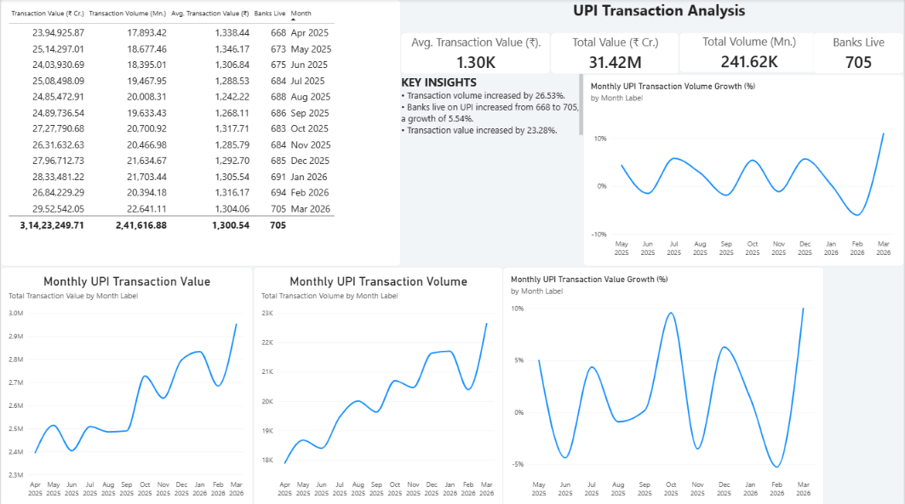

# UPI Transaction Analysis

## 1. Project Overview

This project analyzes monthly Unified Payments Interface (UPI) transaction statistics in India using Microsoft Excel, PostgreSQL, and Power BI.

The objective is to understand transaction trends, transaction value, average transaction size, and month-over-month growth during the financial year 2025–26.

## 2. Project Objectives

- Analyze monthly UPI transaction volume and value.
- Calculate average transaction value.
- Measure month-over-month growth.
- Examine changes in the number of banks live on UPI.
- Present findings through an interactive Power BI dashboard.

## 3. Tools & Technologies

| Tool | Purpose |
|---|---|
| Microsoft Excel | Data preparation, calculations, and visualization |
| PostgreSQL | Data querying and analysis |
| Power BI | Interactive dashboard development |
| GitHub | Project documentation and version control |

## 4. Dataset

- Source: [NPCI – UPI Product Statistics](https://www.npci.org.in/product/upi/product-statistics)
- Financial Year: 2025–26
- Period: April 2025 – March 2026
- Records: 12 monthly observations
- Metrics: Banks live on UPI, transaction volume (millions), and transaction value (crores).

The original NPCI statistics were used to prepare the dataset for analysis.

## 5. Analysis Performed

### SQL Analysis

- Data preview and validation.
- Monthly transaction analysis.
- Aggregate functions for summary statistics.
- Month-over-month growth calculations using LAG().
- Average transaction value calculations.

### Excel Analysis

- Monthly transaction trends.
- Average transaction value calculations.
- Growth percentage calculations.
- Charts and dashboard development.

### Power BI Dashboard

- KPI cards for key performance indicators.
- Monthly transaction volume trends.
- Monthly transaction value trends.
- Transaction growth analysis.
- Average transaction value.

## 6. Key Findings

- Total transaction volume: 241,616.88 million.
- Total transaction value: ₹31,423,249.71 crore.
- Transaction volume increased by approximately 26.53% between April 2025 and March 2026.
- Transaction value increased by approximately 23.28% over the same period.

These findings describe changes across the selected 12-month period.

## 7. Project Limitations

- The dataset contains only 12 monthly observations.
- It contains monthly aggregate statistics, not individual transaction records.
- Customer-level, merchant-level, and individual transaction behavior cannot be analyzed using this dataset.

## 8. Project Structure

- `Excel/` – Excel analysis workbook and dashboard.
- `SQL/` – SQL queries used for analysis.
- `PowerBI/` – Power BI dashboard file.
- `Screenshots/` – Dashboard preview images.

## 9. Power BI Dashboard

The dashboard provides an overview of monthly UPI transaction activity, including transaction volume, transaction value, growth, average transaction value, and key performance indicators.

### Dashboard Preview

